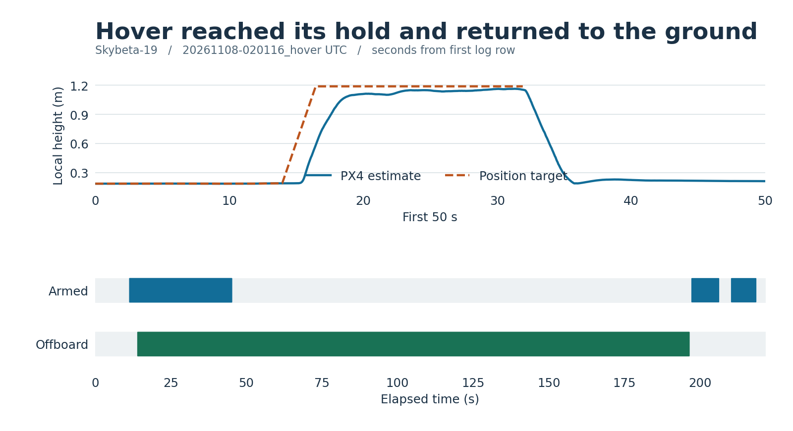
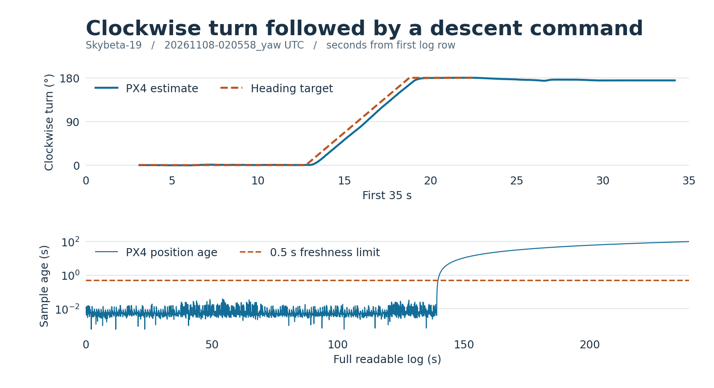
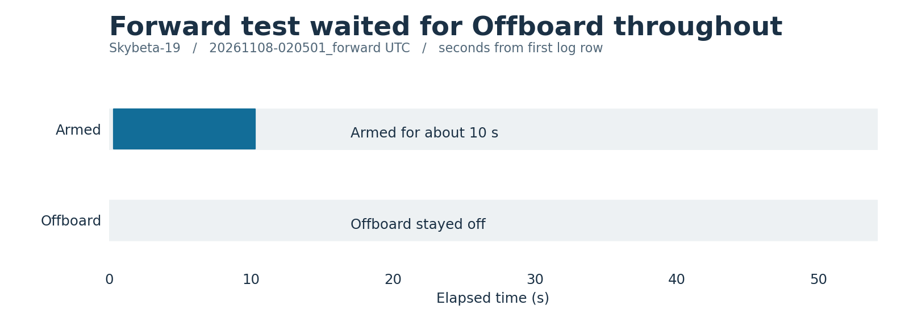

# Skybeta-19 flight recordings · November 7, 2026

Six CSVs were saved by the flight-test recorder on Skybeta-19. Two contain autonomous maneuvers. The hover log records a 10-second hold and a landing. The yaw log records the turn and descent, then ends with an incomplete record. The forward test never entered Offboard.

| Start (Pacific) | Original recorder file (UTC) | Recorded outcome |
|---|---|---|
| 5:56:26 p.m. | [Hover startup](logs/20261108-015626_hover.csv) | 3 rows, all waiting and disarmed. |
| 5:57:27 p.m. | [Yaw startup](logs/20261108-015727_yaw.csv) | 2 rows, all waiting and disarmed. |
| 5:58:28 p.m. | [Forward startup](logs/20261108-015828_forward.csv) | 2 rows, all waiting and disarmed. |
| 6:01:16 p.m. | [Hover and landing](logs/20261108-020116_hover.csv) | Climb, hold, descent, then `DONE`. The last row reports landed and disarmed. |
| 6:05:01 p.m. | [Forward handover attempt](logs/20261108-020501_forward.csv) | Armed for about 10 seconds. All 1,084 rows report `WAIT` and Offboard off. |
| 6:05:58 p.m. | [Yaw and descent](logs/20261108-020558_yaw.csv) | Reached the yaw target within the controller’s tolerance and entered descent. Last readable row reports landed and disarmed, with the controller still in its landing step. |

## Hover

The commanded height rose from about 0.19 m to 1.19 m in PX4’s local frame. The controller entered its hold at 21.9 s and its descent at 31.9 s. PX4 reported landed at 43.2 s and disarmed at 45.2 s. The recorder kept running. Its Offboard flag stayed high until 196.4 s, when the controller logged `DONE`. The long green bar includes time on the ground.

## Yaw

The clockwise turn began at 12.8 s. Heading is plotted relative to the heading at the start of the climb and unwrapped through ±180° so the turn reads continuously. The controller entered descent at 22.6 s. The recorded PX4 position age later exceeded the 0.5 s freshness limit at about 140 s, well after the disarm indication at 33.7 s. The CSV still records downward velocity commands during this stale interval. Those values describe commands, not measured descent.

## Forward

Arming was recorded at 0.3 s and disarming at 10.3 s. The Offboard flag stayed low and the controller never advanced to its movement step. The log does not establish why handover did not occur.

## Reading the evidence

The raw CSVs are preserved byte for byte from the archived aircraft folder `~/team_ws/flight_logs`. The filenames use UTC, which had already advanced to November 8. Plot time is elapsed recorder time from each CSV’s first row. Blue and green bands mark true status flags. Position, heading, and status are onboard estimates and reports. The CSVs contain no independent ground-truth measurement or flight grade.

The yaw file contains 3,858 NUL bytes in a damaged trailing line. The figures use the 4,789 intact data rows and omit the damaged line. No values were filled in. Position targets end when the controller switches to velocity commands for descent.

The installed recorder and controller matched [commit 20aaee79](https://github.com/RaagaSundar/Navless/commit/20aaee7913cc608ae524eeecdecb53af9e8d7055) when inspected. The CSVs do not embed a per-run commit hash. To regenerate the three images, run `python3 plot.py` in this directory with Matplotlib and NumPy installed.
