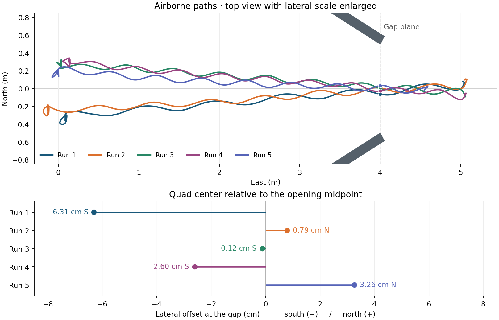

# Funnel world and Jetson opening alignment

## Recorded flight results

All five windy simulations crossed the 1 m opening and landed with zero recorded wall contacts. Four completed the planned far-side landing. The operator stopped the batch during run 5, after crossing, and requested an early landing. The recorded optical observations, flight paths, and simulator wind are from the Mac PX4/Gazebo and Jetson cuVSLAM/OpenCV setup.

| Run | UTC run ID | Seed | Start offset | Offset at gap | Landing beyond gap |
|---:|---|---:|---:|---:|---:|
| 1 | [20261108T034904Z](runs/20261108T034904Z/flight/result.json) | 1058784111 | 30.64 cm south | 6.31 cm south | 1.03 m |
| 2 | [20261108T035354Z](runs/20261108T035354Z/flight/result.json) | 2693231125 | 20.04 cm south | 0.79 cm north | 1.05 m |
| 3 | [20261108T035659Z](runs/20261108T035659Z/flight/result.json) | 409250586 | 24.09 cm north | 0.12 cm south | 1.05 m |
| 4 | [20261108T040016Z](runs/20261108T040016Z/flight/result.json) | 3152770479 | 33.94 cm north | 2.60 cm south | 1.05 m |
| 5 | [20261108T040318Z](runs/20261108T040318Z/flight/result.json) | 1746907054 | 20.36 cm north | 3.26 cm north | 0.55 m |



The crossing offset uses the interpolated quad center at the exit plane between the two wall tips. Median absolute offset was 2.60 cm and the largest was 6.31 cm. The sampled airborne wind speed ranged from 0.35 to 1.65 m/s. [Batch summary](runs/20261108T034904Z/batch/summary.json) · [Calm traversal baseline](runs/20261108T034242Z/flight/result.json) · [Preflight-only attempt](runs/20261108T032239Z/run-comparison.json)

### Recheck the measurements offline

Each run includes its comparison and a compressed bundle of supporting evidence. From this directory, extract the bundles to restore the original run-relative paths. Review and plotting require no connection to a simulator.

```bash
for run in runs/*; do tar -xzf "$run/evidence.tar.gz" -C "$run"; done
python3 review_traversal.py runs/20261108T040318Z
python3 summarize_windy.py runs/20261108T034904Z/batch
python3 plot_windy.py runs/20261108T034904Z/batch
python3 -m unittest test_funnel test_passage test_wind_fixture
```

Plotting requires Matplotlib. The geometry and vision tests require NumPy and OpenCV. The bundles include merged flight tracks, controller logs, simulator settings and the relevant wind samples. Raw PX4 ULogs and full DDS recordings are retained in the original local archives.

## Simulation setup

Live runs require the installed [split simulator](../INSTALL.md), the Mac PX4 SITL build under `split_sim/state/PX4-Autopilot`, the prepared Jetson software, and exclusive use of simulation domain 219. See the [Jetson runbook](../../docs/JETSON_SIMULATION.md). Team flight approval is required for every new flight plan.

Open the standalone Gazebo Harmonic world with `gz sim funnel.sdf`. The two 4 m panels are 1.73 m high and 0.10 m thick. Their inner downstream corners are at ENU (4, +0.5) and (4, −0.5) m. Both panels have visual texture for stereo tracking. The wide end faces the origin.

From this directory, `bash run_bench.sh` runs the fixed-camera test on Jetson 19 and archives the images, logs, world and comparison under `runs/<UTC ID>`. It uses the installed simulation camera model and stereo-only cuVSLAM. The optical observer estimates the midpoint between the two wall boundaries on three scanlines above the horizon. It expects a level camera and bright background. The bearing is positive to camera right.

The first approved flight is archived in `runs/20261108T030458Z`. Its Gazebo dynamics and PX4 SITL ran on the Mac, and the camera processing and flight controller ran on Jetson 19. The independent recorder uses simulator truth for scoring. The navigation inputs are ordinary ROS camera, CameraInfo, tracking and PX4 messages. The simulated downward laser uses collision geometry and the existing noisy range model.

`prepare_sitl.sh` stages a fresh, disarmed split environment. The approved flight also used the project's telemetry station, independent recorders and run-scoped readiness check. The original local run directory contains the patched pilot and PX4 ULog. The published evidence bundle contains the settings, track and mission log. The separate `hover.patch` adapts the course mission interface for a stationary hover. `python3 review.py runs/20261108T030458Z` reproduces the recorded metrics.

The authorized maneuver was a 1 m climb, five-second aiming hover and in-place landing. Camera-right error is applied to NED yaw, limited to 5 degrees per second and 10 degrees from launch heading. The flight did not traverse the gap.

## Through-gap traversal

Build the floor-textured version with `python3 build_world.py --traversal`. It keeps the same collision geometry and adds visual floor features for the exit. The Jetson estimates range from the known 1 m width and calibrated pixel span, transforms the midpoint through camera TF and capture-time cuVSLAM into the launch frame, and checks agreement across frames. PX4 follows short position targets at up to 0.25 m/s. Within 1.2 m of the exit, while laterally aligned, the pilot freezes the measured midpoint and continues with live fused odometry to a landing point 1 m beyond. The optical range estimate assumes a nearly front-on view of the opening.

For a fresh disarmed simulation, run `bash prepare_sitl.sh traversal` and then `bash stage_traversal.sh RUN_ID`. Run `bash fly_traversal.sh RUN_ID --team-approved` only for a team-approved attempt. After landing, merge the independent recorders and use `python3 review_traversal.py runs/RUN_ID` to check the exit-plane intersection, contact reports and final landed state.

## Random offset and gusts

Run `bash prepare_sitl.sh windy-traversal` to sample a launch position and periodic crosswind. An optional integer seed reproduces the draw, for example `bash prepare_sitl.sh windy-traversal 1058784111`. The lateral offset is 0.20–0.34 m to either side of center, with up to 0.15 m of fore/aft variation. The initial yaw and flight controller are shared with the calm traversal.

Gazebo WindEffects applies a horizontal wind to the simulated base link. The mean is 1 m/s across the funnel with a sinusoidal gust of 0.65 m/s amplitude and a seeded period of 4–7 simulated seconds. The assumed force scale is 0.18 per second. This is a simplified disturbance model. `wind-fixture.json` records the seed and parameters, and `wind.jsonl` records the simulator wind field and link state separately from navigation. Gust phase follows the world simulation clock, so flight start timing affects the wind encountered even when the seed is reused.
